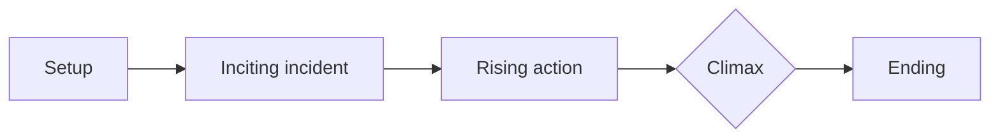
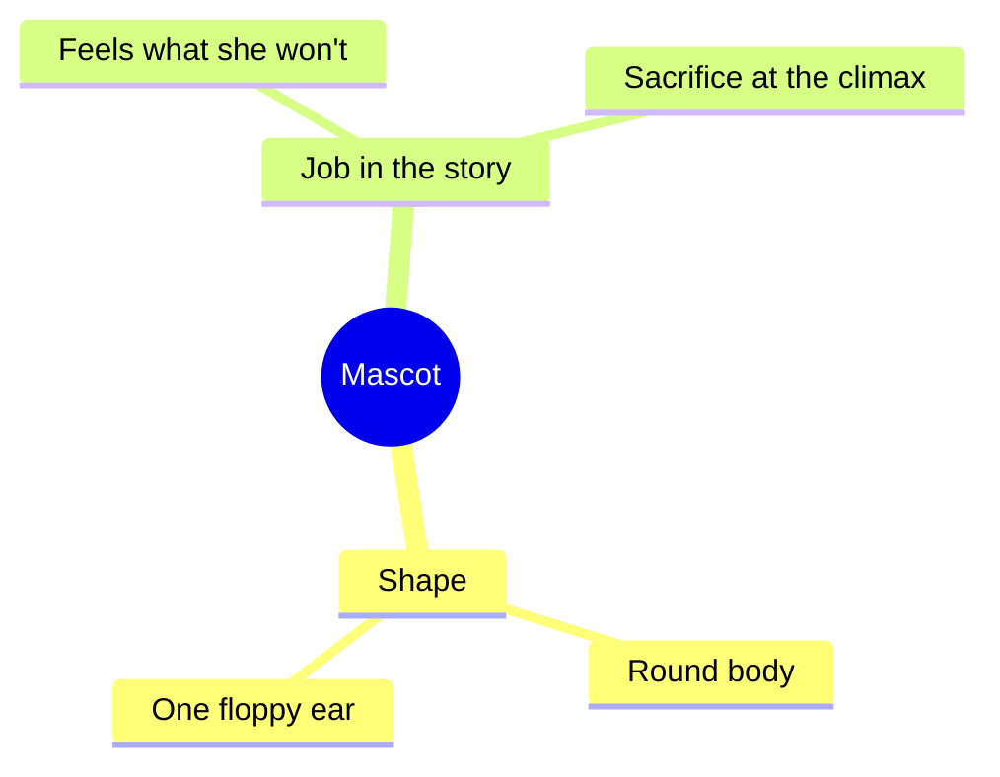
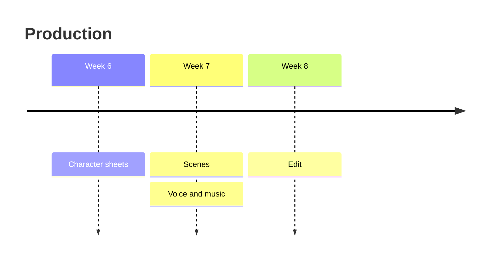
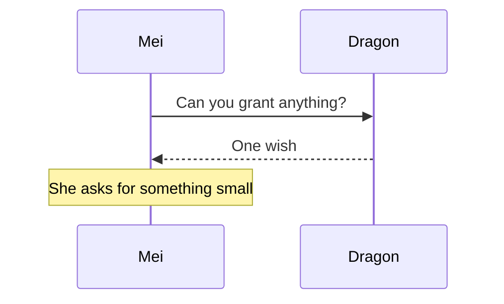

# Colors and diagrams

Notes can be color-coded in two ways, and any note can hold diagrams that redraw themselves with clean lines and shapes.

## Color-coding a note

Every document page has a **Colors** switch above it: **Off**, **Levels**, or **Sections**. Try them on any page. The switch only changes what you see in this browser; to make a choice part of the note, put it in the frontmatter:

```yaml
---
title: Character ideas
colors: sections
---
```

- **`colors: levels`**: each layer of the hierarchy has its own color. `##` headings are amber with a thin rule under them, `###` subheadings teal, `####` violet, and body text a cool off-white, with teal list bullets.
- **`colors: sections`**: each `##` section (one topic) becomes a panel with a colored line down its left edge, alternating teal and amber, so neighboring topics never blur together. Use a `##` heading whenever the topic changes.
- **`colors: off`**: plain.

A folder's `README.md` can set `colors:` for everything inside it, and a note's own frontmatter overrides it. Your [Notebook](/notebook) uses `levels`; [Inspiration](../inspiration/README.md) uses `sections`. The print versions keep the colors, in darker inks for paper.

## Drawing a diagram

The quickest way: open **[Diagram](/diagram)**, pick a starting shape (steps, mind map, story arc, characters, timeline, or conversation), change the words, and watch the preview redraw. Then **Save as a note**, or choose a note under **Save to** to add the diagram as a new section at the end of it. Every note in your Notebook has an **+ Add a diagram** link that opens Diagram pointed at that note.

You can also type a diagram straight into any Markdown file as a `mermaid` code block. It's drawn wherever the page is shown, and GitHub and Obsidian draw it too:



That's this, in Markdown:

````markdown

````

If a diagram has a mistake, the page shows what went wrong and the text you wrote, so a half-finished diagram never breaks a note.

### Flowcharts: the shapes you'll use most

`flowchart TD` runs top to bottom; `flowchart LR` runs left to right.

| Write | Get |
| --- | --- |
| `A[Text]` | a box |
| `A(Text)` | a rounded box |
| `A([Text])` | a pill, good for people |
| `A((Text))` | a circle |
| `A{Text?}` | a diamond, for a question or choice |
| `A --> B` | an arrow |
| `A -- label --> B` | an arrow with words on it |
| `A -.-> B` | a dotted arrow, for something uncertain |
| `A --- B` | a plain line |
| `A:::c1` | amber; `:::c2` teal, `:::c3` violet, `:::c4` rose, `:::muted` dashed grey |
| `subgraph Act 1 ... end` | a labeled group around some shapes |
| `<br/>` inside a label | a line break |

### Mind maps

Indentation makes the branches; the branches take the note colors in turn.



### Timelines and conversations





Mermaid can draw more (class, state, Gantt, and pie charts); see the [Mermaid docs](https://mermaid.js.org/intro/).

## Diagrams from dictation and photographs

- **[Dictate](/dictate)**: describe a diagram out loud ("make a diagram: the scroll leads to the creature, the creature leads to the dragon…") and the cleaned-up note includes it as a `mermaid` block.
- **[Transcribe](/transcribe)**: photograph a page with boxes and arrows you drew by hand, and the transcription redraws it as a clean `mermaid` diagram with your labels and connections. Your photograph is still at the bottom of the note to check it against.

Check these the way you'd check any transcription: the model can misread a label or an arrow. Fix the text in the code block and the diagram redraws.
