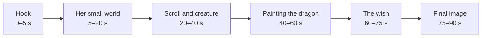
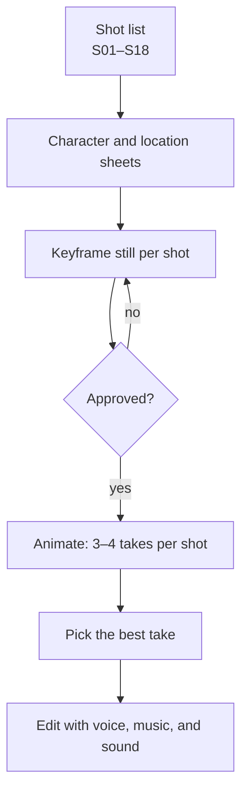
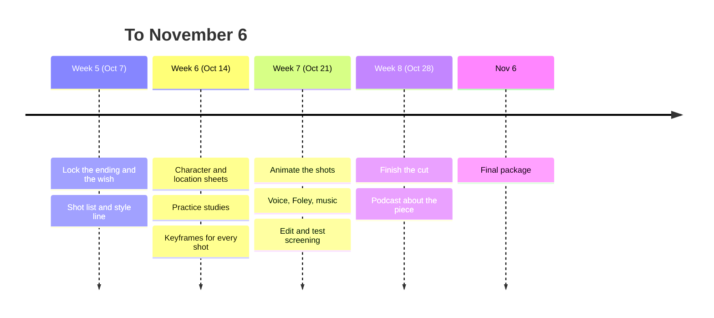

# Making the AI short drama

These are Claude's ideas for making the project on your [inspiration board](../inspiration/inspiration-board.md): a short, emotional fantasy drama about a quiet, over-mature girl, a magic brush, an ink creature, and a dragon on a scroll. They're suggestions to test in your [practice studies](practice-studies.md), not rules. When something works or fails, write it down in your [Notebook](/notebook). The production details (shot numbers, separate audio, character sheets) are covered in [Preventing common errors](../inspiration/preventing-common-errors.md), so this page links to it rather than repeating it.

## 1. Make it small enough to finish

The most common way an AI film fails is by being too big. You have about four weeks, and every shot costs several generations. Aim for:

- **60 to 90 seconds**, vertical (9:16) if it's a short for phones, like the AI drama series you collected.
- **One main location** (the house and its courtyard), so the backgrounds stay consistent.
- **Three characters at most**: the girl, the creature, and the dragon. Keep the grandfather mostly off screen: a cough from the next room, a hand, a shape in bed. It's easier to generate and more affecting.
- **About 15 to 20 shots.** At 4 to 6 seconds each, that's your running time.

If the story needs more, make it **Episode 1** and end on a cliffhanger, the way the series on your board do. A finished minute is worth more than an unfinished five.

## 2. Write the ending first

You said you like a story where the conflict is mysterious, then revealed, then looks hopeful, and still wins in the end. That's a strong shape for a short, because the last shot carries the emotion. Decide the final image before anything else, then work backward.

The premise turns on the wish. A few ways to go, to think over (or replace with your own):

- **She wishes for something tiny for someone else**: her grandfather's favorite meal, one more good day. The audience expected her to ask for a cure.
- **She wishes for nothing for herself**, and the creature (who "notices she's never asked for anything") spends itself to give her something anyway.
- **The tragic turn**: the wish works, but dotting the dragon's eyes costs the creature, which was made of the same ink. Hope, and then the loss.

The legend helps here. "Painting the dragon and dotting its eyes" (*huà lóng diǎn jīng*) is a Chinese idiom for the final touch that brings a work to life. Your last brushstroke can be the turning point.

- **Hook (the first 3 to 5 seconds)**: shorts are judged before the viewer decides to stay. Open on something strange or tender, such as ink moving on its own, or her setting out two bowls and eating from neither.
- **Her small world**: show her competence and what she does without (see "Building the emotional core" on your board). No explanation; let objects tell it.
- **The middle**: the creature's comedy brings the warmth that makes the ending hurt.
- **The final image**: hold it longer than feels comfortable.

## 3. Script for pictures, not for talking

Lip sync is still the weakest part of AI video, and a short drama doesn't need much dialogue anyway.

- **Write the script as a list of shots**, not pages of dialogue. Each line is something we see.
- **Keep spoken lines to a handful**, and short. Put them on shots where we can't see her mouth clearly: from behind, in silhouette, over the shoulder, or as voiceover over her hands working.
- **Let the creature communicate with a sound** (the "squeak, chirp, or hum" from your mascot checklist) instead of words.
- **One line can carry the film.** "It's okay. I didn't need one," said to the creature, does more than a speech.
- Read the script aloud with a timer. If it runs over 90 seconds spoken, cut words, not shots.

## 4. Design before you animate

Get the look locked in stills, where fixing is cheap, before you spend anything on video.

1. **Write a style line** you paste into every prompt, word for word: for example, "ink-wash illustration, cream paper texture, indigo and cobalt ink with a soft cyan glow, quiet morning light."
2. **Make a character sheet for the girl and the creature** (front, side, three-quarter, a few expressions), with one or two simple identifiers that survive regeneration: a red ribbon, an ink-drop patch.
3. **Make a location sheet**: the room, the courtyard, the scroll on the table, at the same time of day.
4. **Generate a keyframe still for every shot**, approve them all side by side, and only then animate.

Ink-wash is a good choice for AI: a painterly style hides small inconsistencies that would jump out in photorealism.

## 5. Build it shot by shot

- **Number every shot** and name every file by it (S07_v3.mp4). Follow the folder structure in [Preventing common errors](../inspiration/preventing-common-errors.md).
- **Generate several takes per shot and pick one.** Budget for it: if you can afford 60 generations, that's 3 to 4 per shot for about 18 shots.
- **Keep motion simple.** One action per shot: she lifts the brush; the ink spreads; the dragon opens its eye. Complex movement is where faces and hands fall apart.
- **For the dragon-drawing shot**, use the methods from your board: start and end frames, staged stills (tail, body, head, eyes), or the reverse trick of animating ink dissolving and playing it backward. This is your signature shot, so practice it first.
- **Cut around weaknesses** rather than regenerating forever: a cutaway to hands, the creature's reaction, or the paper itself covers a bad half-second.

## 6. Sound is half the emotion

Audiences forgive imperfect pictures much more readily than bad sound, and sound is where you can do real, non-AI craft.

- **Record your own Foley** (sound effects). A real brush on real paper, a bowl set down, rice being scooped, wind, a paper scroll unrolling. These are easy to record on a phone and will make generated pictures feel physical.
- **Keep every voice line as its own file**, named by shot, so a mispronunciation means regenerating one line. Spell names phonetically for the voice tool if needed.
- **Music: less than you think.** Bring music in late, let silence sit under the quiet scenes, and let the music rise at the wish. If you generate music, check the tool's terms for what you're allowed to publish.
- **Room tone**: a low bed of quiet ambient sound (birds, a distant cough) makes cuts between generated clips feel continuous.

## 7. Edit for feeling

- **Cut on action**: change shots in the middle of a movement (the brush lifting, a head turning), and the eye won't notice the clips came from different generations.
- **Hold emotional shots longer**, and cut comedy beats short. That contrast is the rhythm of the films on your board.
- **Use J-cuts**: let a sound start before its picture (the dragon's breath before we see it).
- **Add captions** burned into the picture. Most shorts are watched with the sound off.
- **Show it to someone who doesn't know the story.** Ask only: what did she wish for, and how did you feel at the end? If they can't tell you, the ending needs to be clearer, not longer.

## 8. Keep a production log

The final package asks you to explain where and how you used AI, and the podcast will ask about your choices. Make that easy now: keep one note in your Notebook with a row per shot.

| Shot | What we see | Tool | Prompt (or file) | Takes | Kept | Notes |
| --- | --- | --- | --- | --- | --- | --- |
| S01 | Ink moves on the scroll | (video tool) | prompts/S01.txt | 4 | v3 | v1–2 changed her face |

Also note what you made yourself: the Foley, the edit, the script, any drawings. That's the "what you and your tools contributed" part of the assignment.

## 9. Respect the sources

- **The legend** of Zhang Sengyou and the dotted eyes is real cultural history. Read a source on it (add it to [Readings](../readings/README.md)) so your retelling is informed, and credit it.
- **Clothing and setting**: decide on a time and place and look at real references (museum open-access collections are on your board), rather than letting the model mix eras.
- **Inspiration, not copying**: study how *Spirited Away*, *Kubo*, and the AI series do things, but don't prompt for their characters or styles by name.

## 10. Schedule

By the end of this week: a written ending, a one-paragraph premise, a shot list, and a style line. Those four things make every later step faster.
