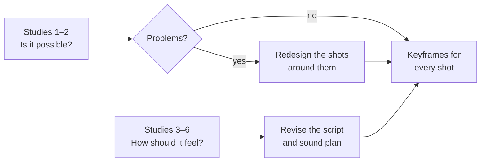

# Practice studies for the AI short drama

Week 6 asks you to break the project into skills you can rehearse. These six studies each test one thing the [ink-dragon short](making-the-ai-short-drama.md) depends on. Each one is small enough to do in an hour or two. Do them in roughly this order, since the first two decide whether the film is possible as planned.

For every study, keep the attempts side by side and write a short Notebook entry: what you tried, what changed between attempts, and what you'd do next time. The comparisons are the evidence of what you learned, for the podcast and the final reflection.

## Study 1: Can you keep her the same?

**The skill:** character consistency.

1. Make the girl's character sheet and write her locked description.
2. Generate her in five different shots: close-up, full body, from behind, at the table, in the courtyard.
3. Put the five side by side.

**Compare:** what drifts (face shape, hair, ribbon side, clothing pattern)? Which identifiers survived every time? Try again with a simpler description and stronger identifiers, and see whether it holds better.

## Study 2: The dragon draws itself

**The skill:** your signature shot.

Make the dragon-drawing shot two or three ways, using the methods on your [inspiration board](../inspiration/inspiration-board.md#how-to-animate-it-with-ai-tools): start and end frames, staged stills, and the reverse trick (ink dissolving, played backward).

**Compare:** which looks most like a brush is actually painting it? Which keeps the strokes in a believable order? If none work, that's important to know now: you can redesign the moment (for example, cut between her brush and the finished stroke) before it's in the shot list.

## Study 3: A scene with no words

**The skill:** telling emotion through objects and gesture.

Make a three-shot micro-scene of her eating alone with no dialogue: two bowls set out, rice scooped into one, her hands. Then make it again with one line of voiceover.

**Compare:** show both to someone. Which version did they understand? Which did they feel more? This tells you how much dialogue the film really needs.

## Study 4: Her voice

**The skill:** voice casting and pronunciation.

Generate the film's two or three most important lines in a few voices. Include a name or word that's hard to pronounce (a Chinese name or place) and fix it with phonetic spelling.

**Compare:** which voice sounds the right age and doesn't sound like an adult acting young? Note the exact spelling that fixed each pronunciation, so you can reuse it.

## Study 5: Sound only

**The skill:** Foley and sound design, made without AI.

Record ten sounds the film needs on your phone: brush on paper, ink dripping, a bowl set down, rice, a scroll unrolling, wind, a door, footsteps, breathing, a creature "voice" (your own, pitched up later). Lay three of them under a generated clip that has no sound.

**Compare:** play the clip silent, then with your sounds. Write down what the sound added. This is the strongest part of the film that's entirely your own work.

## Study 6: Two cuts of the same clips

**The skill:** editing rhythm.

Take six clips from your studies and edit them twice: once fast (short shots, cuts on action), once slow (long holds, silence before the last shot), each about 20 seconds.

**Compare:** which one feels more like the AI drama series on your board? Which one makes the ending land? Most likely the answer is fast in the middle and slow at the end, but find out for yourself.

## After the studies

Update your plan with what you learned:

Then revise your shot list. Any shot your studies showed to be unreliable should be redesigned now, not in week 7.
