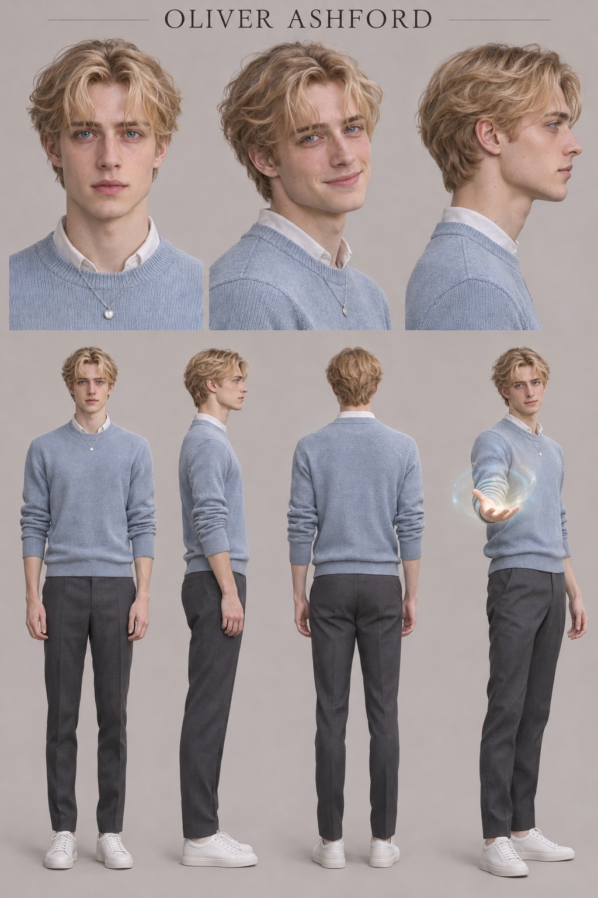
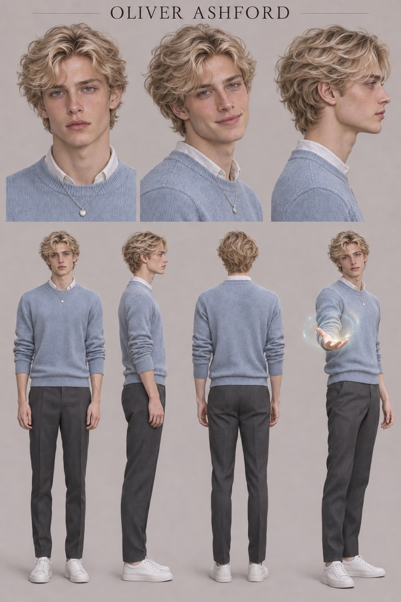
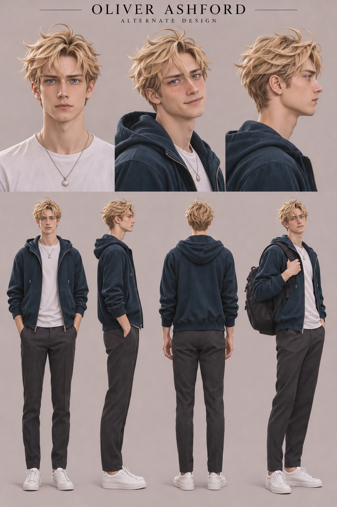
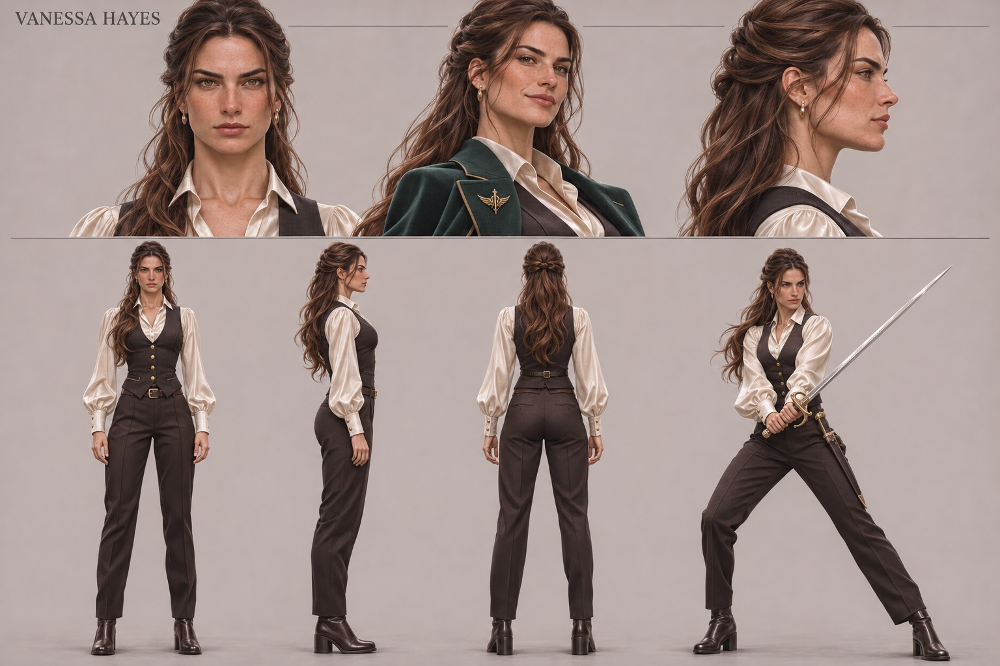
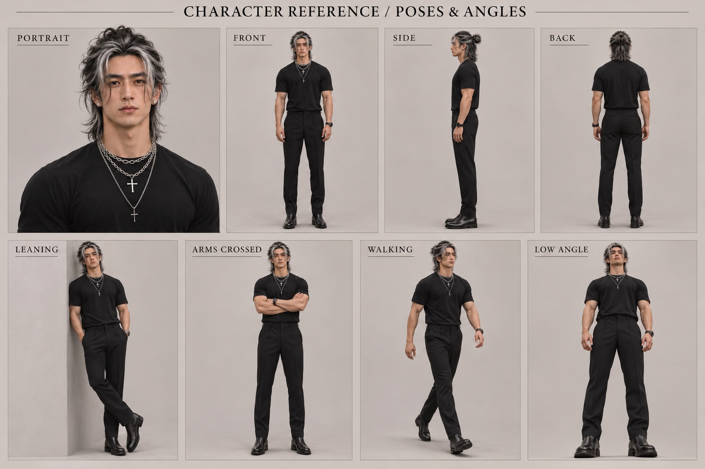
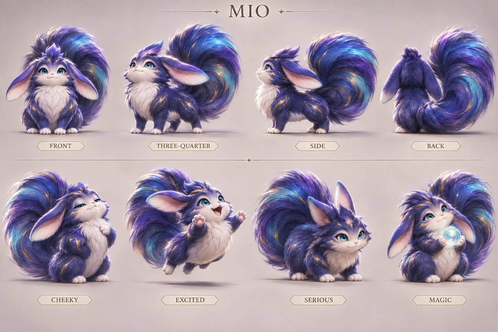

My character bible, from the **british twink mc** tab of my [inspiration doc](https://docs.google.com/document/d/17gIm47t000_5_PasGklTHhs3f8hmvAtOcnp2sxa1ZIo/edit). Each character has a description of how they look, and a voice description I used to generate their voice. Each one also has a character sheet I made with ChatGPT in week 6, so the video generator would keep the design consistent from every angle.

## Oliver Ashford (Ollie)

**Oliver Ashford**: mc, nickname is ollie. an adult in his mid-twenties: 5′10″, around 150 pounds, slender build, fine blond hair, blue eyes, and delicate features

  - An adult British man in his mid-twenties with a light, medium-high speaking voice. Clear and smooth, with gentle warmth, a slightly airy edge, and precise but relaxed articulation.
  - Speaks with a contemporary southern English accent: educated and natural, without exaggerated aristocratic pronunciation. His rhythm is conversational and emotionally expressive. Embarrassment brings small hesitations, caught breaths, and a slightly quicker pace. When comfortable, he becomes dryly witty and gently teasing.
  - During healing or moments of danger, his delivery steadies: calm, attentive, and reassuring. His voice carries vulnerability without becoming persistently whiny or childish. Romantic lines are soft and sincere, with the occasional word escaping more honestly than he intended.
  - V1 meh (my note on the first version)

### Character sheets

Each sheet shows his face from the front, three-quarters, and side, then his full body from the front, side, back, and healing.

In the opening, make him look pitiful through his behavior: clutching an overstuffed bag, trying to straighten his clothes, and struggling to keep his voice steady.

## Vanessa Hayes, the guildmaster

- Brunette hair, athletic build, distinctive face, and one combat outfit that also works at the office

### Her voice (draft, for me to confirm)

The voice under Vanessa's name in the doc doesn't fit her. It describes someone who is sweet on the surface but cutting, and dismissive of Oliver's distress, which is Celeste, the ex. This is Claude's draft of a voice that fits Vanessa's role in the script, in the same format as the others:

- An adult American woman in her mid-twenties with a clear, medium-low voice, firm projection, and crisp, efficient articulation. Speaks contemporary American English with natural authority, like someone used to giving orders in the field.
- In combat her delivery is short and commanding, with clipped phrases and no wasted words ("Ashford. Stay close."). Under pressure she gets steadier and louder, never shrill.
- Around Oliver, the edge softens into dry, direct warmth. She doesn't flirt with words so much as with plain statements and pauses that last a beat too long.
- In her confession, her confidence holds but slows: a small breath before the line, then she says it straight. Keep it grounded and sincere, without breathiness or melodrama.

### The voice in the doc (probably Celeste's)

- An adult woman in her mid-twenties with a smooth, medium-pitched voice, bright clarity, and meticulously crisp articulation. Speaks contemporary American English with polished, unhurried confidence.
- Her delivery has a surface sweetness that turns cutting through emphasis and timing. She makes dismissive remarks sound casually obvious, as though Oliver's distress is a tedious inconvenience. A faint smile is audible in her most hurtful lines.
- When challenged, the sweetness disappears and her voice becomes clipped and cold. Keep the performance believable and controlled, with occasional theatrical relish rather than constant sneering or shouting.

## Adrian Ouyang, the childhood friend

ChatGPT's script calls him "Ethan Chen". I chose **Adrian Ouyang**.

  - Face, muscular build, hairstyle, jewelry, and work outfit
  - A 25-year-old man with the polished, masculine vocal presence of a K-pop idol speaking casually. A medium-low natural speaking register with warm, full resonance. Mostly smooth, with a subtle gravelly edge that becomes more noticeable on quiet phrases and sentence endings.
  - Speaks natural, conversational American English, with a slight asian accent like kpop idols. His pacing is measured, with brief, intentional pauses and relaxed, clear articulation. Warm, self-assured, and quietly commanding. He sounds comfortable taking charge without needing to raise his voice.
  - Around Oliver, his tone becomes softer and more intimate, with understated teasing and an audible smile. He gives familiar nicknames an affectionate emphasis. During his confession, a slight hesitation reveals how much Oliver’s answer matters to him.
  - Keep the delivery natural and conversational. The gravel is a light texture, without forced growling, excessive vocal fry, or constant breathiness.

## Mio

**Miozareth Aurelion, Keeper of the Azure Flame, Guardian of the Seventh Heaven**

See [Designing Mio](designing-mio.md) for how the design got there.

  - A small magical creature with a youthful, gender-ambiguous voice. High-pitched but pleasant and comfortable to hear, with a light, clear tone, a faint airy edge, and an occasional tiny squeak when excited.
  - Speaks clear, conversational American English with a bouncy rhythm, playful pitch changes, and crisp consonants. Cheeky, mischievous, and completely confident in his own importance. He delivers grand declarations with absolute sincerity and sounds mildly offended when humans fail to appreciate his greatness.

## Setting

Modern Boston-inspired city, contemporary apartments, glass office towers, cinematic semi-realistic drama style.
